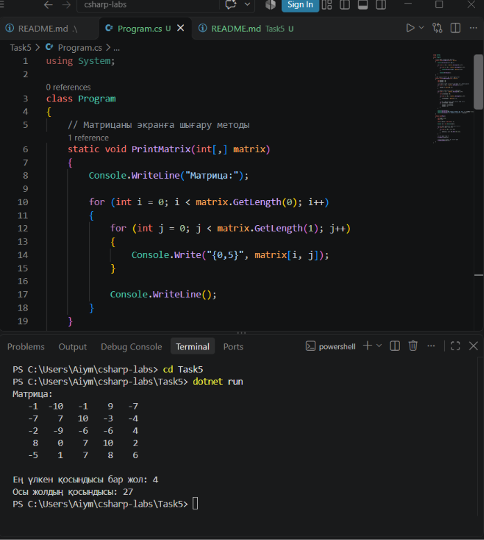

#5-тапсырма: Екі өлшемді массивтер (4-нұсқа)

## Тапсырманың мақсаты

5×5 өлшемді int типті матрица құру, оны кездейсоқ сандармен толтыру және экранға шығару. Әр жолдағы элементтердің қосындысын есептеп, қосындысы ең үлкен жолдың нөмірін анықтау.

## Тест нәтижелері

| Тест | Кіріс | Күтілетін нәтиже |
|---|---|---|
| Жеке тест | Random(11) | 4-жол, қосындысы 27 |
| Өз тестім 1 | 1-жол: 1, 2, 3, 4, 5; 2-жол: 2, 3, 4, 5, 6 | 2-жол, қосындысы 20 |
| Өз тестім 2 | 1-жол: -1, -2, -3, -4, -5; 2-жол: -2, -2, -2, -2, -2 | 2-жол, қосындысы -10 |

## Сұрақтарға жауап

**1. matrix[i, j] жазбасында i мен j нені білдіреді? matrix.GetLength(0) және matrix.GetLength(1) не қайтарады?**

i – матрицаның жол индексі, ал j – баған индексі. GetLength(0) жол санын, GetLength(1) баған санын қайтарады. Бұл бағдарламада екеуінің де мәні 5.

**2. Ең үлкен қосындының бастапқы мәнін неге 0 емес, бірінші жолдың қосындысы деп алдыңыз?**

Себебі матрицадағы барлық элементтер теріс болуы мүмкін. Егер бастапқы мәнді 0 деп алсақ, бағдарлама нақты ең үлкен қосындыны дұрыс анықтамауы мүмкін. Сондықтан бірінші жолдың қосындысын бастапқы мән ретінде қолдандым.

**3. Кодыңыздағы ішкі цикл неше рет орындалады?**

Матрица 5×5 өлшемді болғандықтан, ішкі цикл әр жолда 5 рет орындалады. Барлық жол бойынша 5 × 5 = 25 рет орындалады.