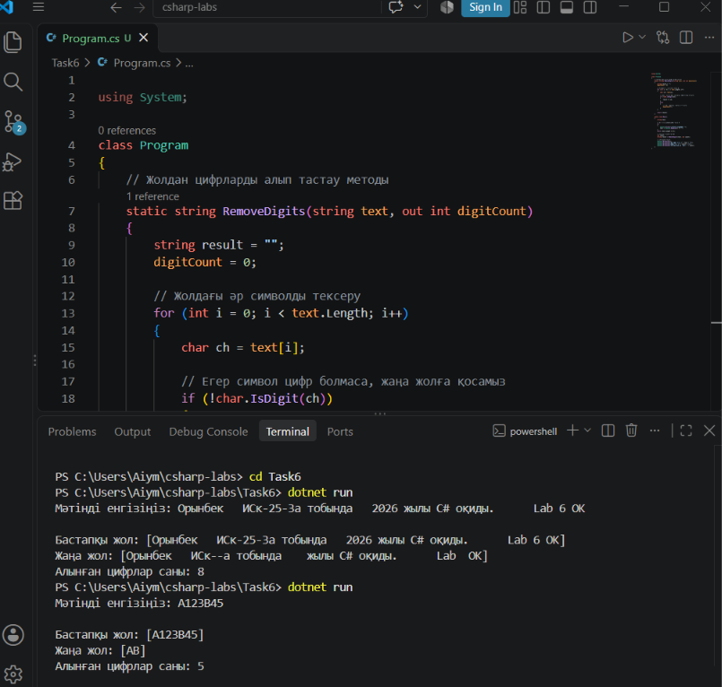

# 6-тапсырма: Символдар тіркесі (нұсқа 2)

Тапсырма: жолдағы цифрларды алып тастап, жаңа жолды және алынған цифрлар санын шығару.

| Тест | Кіріс | Қолмен есептеген жауап | Бағдарлама жауабы |
|---|---|---|---|
| Жеке тест | `   Орынбек   ИС-25 тобында   2026 жылы C# оқиды.      Lab 6   ОК   ` (басында, соңында және ортасында бос орындармен) | Цифрлар: 2, 1, 2, 0, 2, 6, 6 → 7 цифр. Жолдан тек цифрлар жойылады, бос орындар сақталады | 7 цифр, жаңа жол скриншоттағыдай |
| Өз тестім 1 | `A123B45` | `AB`, 5 цифр | `AB`, 5 |
| Өз тестім 2 | `Aiym` (цифр жоқ) | `Aiym`, 0 цифр | `Aiym`, 0 |

## Сұрақтарға жауап

1) `text[i]` жолдың `i`-орнындағы бір символды қайтарады, типі `char`. `text[i] = 'a';` деп жазуға болмайды, өйткені `string` өзгермейтін тип: жолдың ішіндегі символды ауыстыру мүмкін емес, тек жаңа жол жасауға болады.

2) Цифрды `char.IsDigit(ch)` арқылы тексердім, ол символ `'0'`–`'9'` болса `true` қайтарады. `'5'` — `char` типті символ (коды 53), мәтіннің бөлігі, ал `5` — `int` типті сан, онымен есептеуге болады.

3) `result += ch;` кезінде ескі жол өзгермейді, жаңа жол жасалады: ескі `result` пен `ch` қосылып, нәтиже `result` айнымалысына қайта жазылады. Ескі жолды кейін қоқыс жинағыш жояды.

## Кездескен қате

Қате: жеке тестті алғаш іске қосқанда тапсырмадағы жолды дәл жазбадым: `ИС-25` орнына `ИСк-25-3а` енгізіп, жолдың басы мен соңына бос орын қоймадым. Сондықтан цифрлар саны 7 емес, 8 шықты, ал скриншот тапсырма талабына сәйкес болмады.

Қалай түзеттім: тапсырмадағы жолды дәл өзін, басы мен соңында бос орындармен қайта енгізіп, бағдарламаны іске қостым. Нәтиже қолмен есептегенмен (7 цифр) сәйкес келді, содан кейін скриншотты жаңарттым.

1) `task5` тармағында жасаған коммиттерім GitHub-та Pull Request (#1) арқылы `main`-ге біріктірілді, сонда олар `main` тарихына түсті. Біріктіруден кейін `task5` тармағы өшпеді: ол GitHub-та да, компьютерімде де қалды, тарихы өзгерген жоқ.

2) `commit` өзгерістерді тек менің компьютерімдегі жергілікті репозиторийге сақтайды, ал `push` сол коммиттерді GitHub-қа жібереді. Push жасамасам, мұғалім GitHub-та ештеңе көрмейді, өйткені жұмыс менің компьютерімде ғана қалады.

3) `.gitignore` файлын `dotnet new gitignore` командасымен жасадым, онда .NET жобаларына арналған ережелер бар, соның ішінде `bin/` және `obj/`. Бұл қалталарда компиляция кезінде автоматты түрде жасалатын уақытша файлдар тұрады, оларды кодтан әрдайым қайта құруға болады, сондықтан репозиторийді ауырлатпау үшін қосылмайды.

## ЖИ қолдану
Кодқа енгізген өзгерісім: ЖИ берген кодты өзімнің нұсқама бейімдедім: цифрлар санын `out int digitCount` параметрі арқылы қайтардым, консоль хабарламаларын өзгерттім («Мәтінді енгізіңіз», «Жаңа жол», «Алынған цифрлар саны»), түсініктемелер қостым. Кодтың әр жолын түсініп, `char.IsDigit` пен `result += ch` қалай жұмыс істейтінін тексердім, README-дегі жауаптарды өз сөзіммен жаздым.